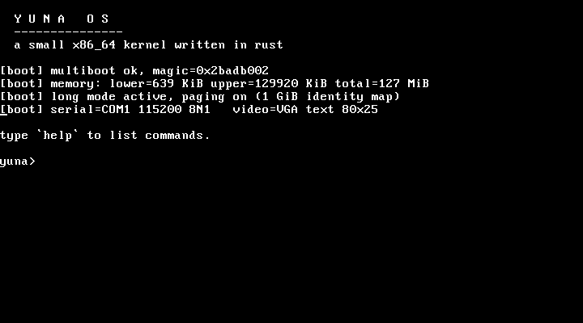

# Yuna OS

A small bare-metal operating system for x86_64, written in Rust with no
dependencies outside `core`.

```
  Y U N A   O S
  ---------------
  a small x86_64 kernel written in rust
```



## What it does

- Boots via the Multiboot v1 protocol (QEMU `-kernel`)
- Brings the CPU from 32-bit protected mode into **64-bit long mode**
- Builds its own 4-level page tables and identity-maps the first 1 GiB with
  2 MiB huge pages
- Loads its own GDT
- Drives the **VGA text buffer** (80x25) and a **16550 UART** on COM1
  (115200 8N1), mirroring all console output to both
- Runs an interactive line shell over serial
- Panics print a message and halt the CPU

## Layout

```
src/main.rs      entry stub (32-bit -> long mode), kernel_main, panic handler
src/io.rs        port I/O helpers
src/serial.rs    COM1 driver, polled receive
src/vga.rs       VGA text-mode writer, scrolling
src/console.rs   console fan-out (VGA + serial) and print!/println!
src/shell.rs     line editor + command dispatch
linker.ld        places .boot (multiboot header) at 1 MiB
tools/repack_elf32.py   multiboot container adapter (see below)
run.sh           build + boot in QEMU
```

## Requirements

On Arch Linux (base install plus these packages):

```sh
sudo pacman -S --needed rustup qemu-system-x86 python
rustup target add x86_64-unknown-none
```

The kernel itself targets **`x86_64-unknown-none`** and is `#![no_std]`,
`#![no_main]`, with `panic = abort` semantics. No nightly features and no
`build-std` are required — the precompiled `core` for the target is enough.

## Build and run

```sh
./run.sh                       # interactive serial console
printf 'help\nhalt\n' | ./run.sh
```

or manually:

```sh
cargo build --release --target x86_64-unknown-none
python3 tools/repack_elf32.py \
    target/x86_64-unknown-none/release/yuna_os \
    target/yuna_os.multiboot.elf
qemu-system-x86_64 -kernel target/yuna_os.multiboot.elf \
    -serial stdio -monitor none -display none \
    -device isa-debug-exit,iobase=0xf4,iosize=0x04 -no-reboot -m 128M
```

## Commands

| command | behavior |
|---------|----------|
| `help` | list commands |
| `echo <text>` | print text back |
| `info` | kernel/boot information |
| `mem` | usable memory reported by the bootloader |
| `ticks` | read the TSC (`rdtsc`) |
| `clear` | clear screen (ANSI + VGA) |
| `halt` | power off via `isa-debug-exit` |

## Why the ELF32 repack step?

QEMU's Multiboot loader refuses ELF64 containers outright. The kernel keeps a
real 32-bit entry stub that switches to long mode, so
`tools/repack_elf32.py` rewrites only the ELF header/program headers into a
32-bit Multiboot container while copying segment contents verbatim. The result
is an ELF32 image whose entry point is the 32-bit stub, which then jumps into
the 64-bit Rust kernel.

## Notes

- No interrupts, no scheduler, no allocator (yet). The shell polls the UART.
- The boot page tables cover the first 1 GiB; do not place memory above that.
- Writing FCR during UART init flushes a byte that arrived before boot, so the
  FIFO is left at its reset state.
